
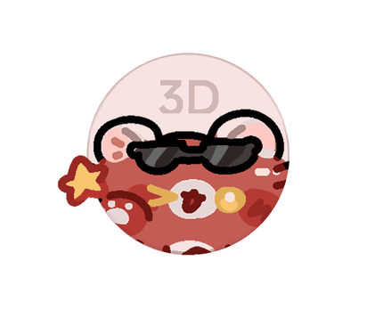

<a href="README.md">中文</a> | <b>English</b>

# R03 Yokky Bear 3D Previewer

**All-in-one 2D-to-3D merch mockup toolbox**

Also known as: R03 Merch 2D-to-3D Preview (Chinese name: R03 小熊猫3D预览机)

Turn your PNG designs into 3D merch mockups you can spin around: acrylic charms, badges (buttons / pins), paper goods, packaging, books and combos. Palettes, watermarks, backgrounds and text are managed in one place under "Settings".

- **Use online**: https://sinyola1314.github.io/R03-Merch-2Dto3D-Preview/?lang=en
- **Use offline**: download `index.html` from this repository and double-click it to open in your browser. No internet and no installation needed.
- **Current version**: V2.6.3 (2026-11-21)
- **Author**: YOKKY (囿一九_YOKKY)

> Your images are processed only in your own browser and are never uploaded to any server. The page doesn't save images or settings either: refreshing or closing it clears everything, so export in time.
>
> Mockups are for reference only. Real colors, bleed, white ink and so on depend on the manufacturer's equipment and batch, so trust the physical product. The author is not responsible for printing differences.

## Language

Switch between Chinese and English in the first section of **Settings**, "语言 / Language", or with the **中 / EN** button on the license screen.

- On first visit, the language follows your browser: Chinese browsers get Chinese, everything else gets English.
- Your choice is remembered in your browser.
- Add `?lang=en` or `?lang=zh` to the link to force a language, e.g. when sharing with friends.

The English interface is new. All items, notes, messages and the tutorial are translated; search currently works with Chinese keywords only, and a few rarely seen messages may still show Chinese. Feedback on wording is very welcome in [Issues](https://github.com/sinyola1314/R03-Merch-2Dto3D-Preview/issues).

## Feedback

- Feature requests and bug reports: [GitHub Issues](https://github.com/sinyola1314/R03-Merch-2Dto3D-Preview/issues). Please include the version number shown at the top left of the page.
- Email: yokkytg@foxmail.com
- User manual (Chinese): [Tencent Docs](https://docs.qq.com/aio/DSU5jbmpYbU5IWmpk)

## Showcase

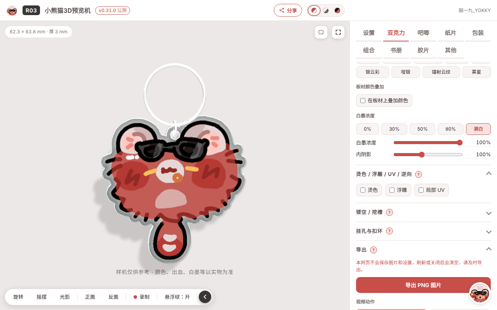

| Acrylic charm turning | Book page turning |
|---|---|
| 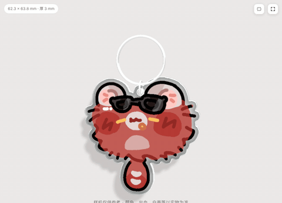 | 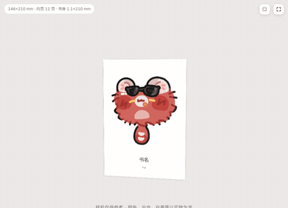 |
| **Paper bag folding from its die line** | **Film strip rolling up** |
| 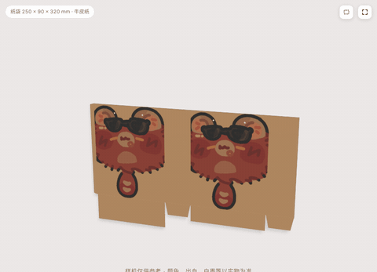 | 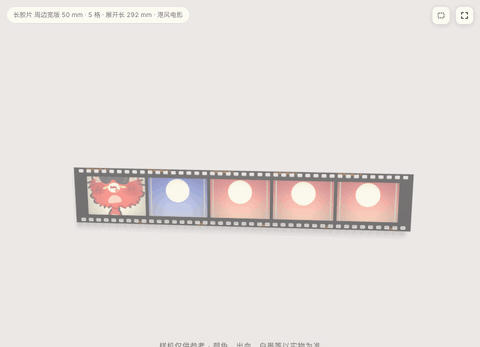 |
| **Binder going from flat to closed** | **Stickers, slogan watermark, stamp** |
| 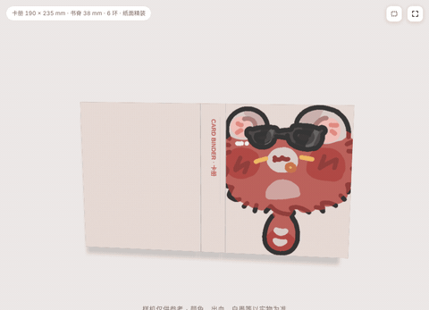 | 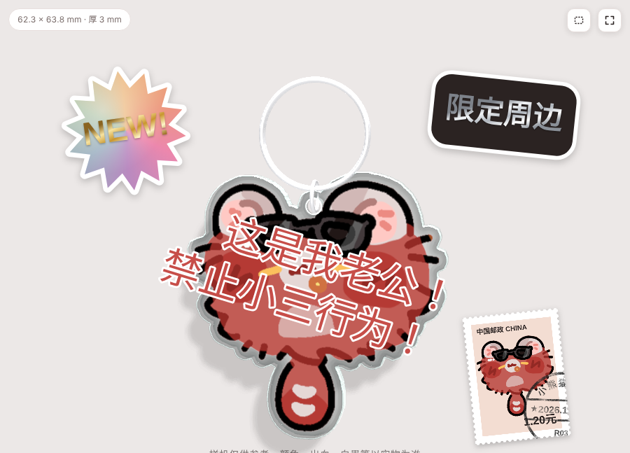 |
| **Acrylic charm + tassel (sways gently)** | **Acrylic shikishi (metallic edge)** |
| 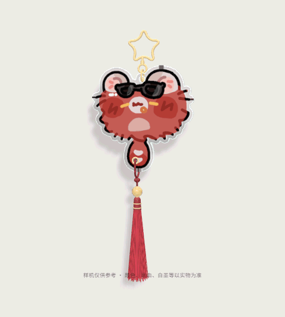 | 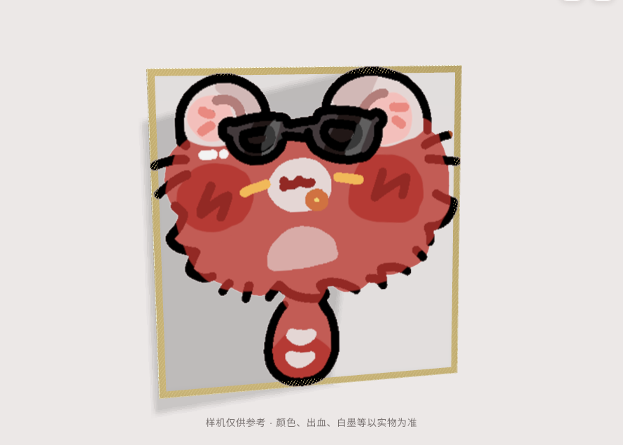 |
| **Can (label wraps around, tin lids)** | **Flowing texture holo base (iridescent ripple)** |
| 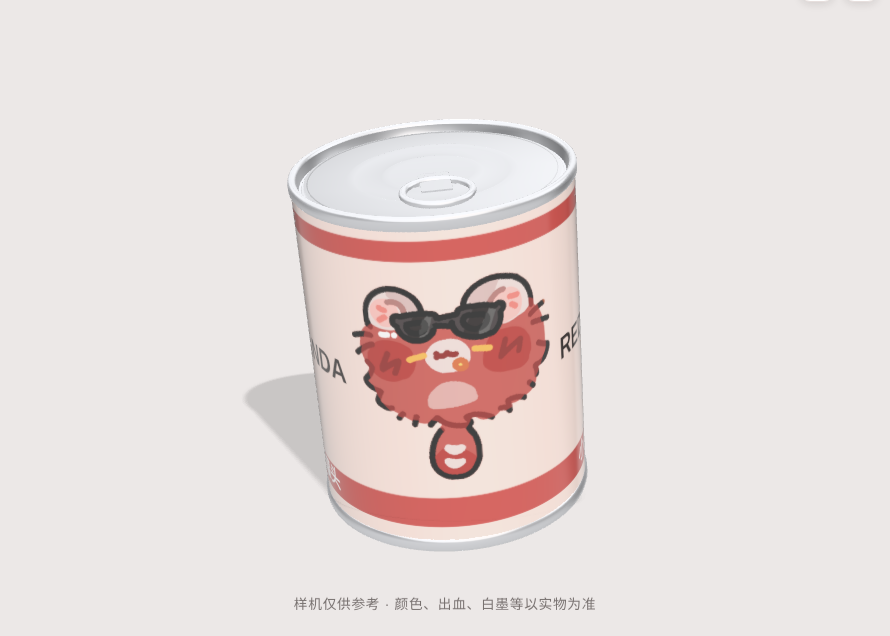 | 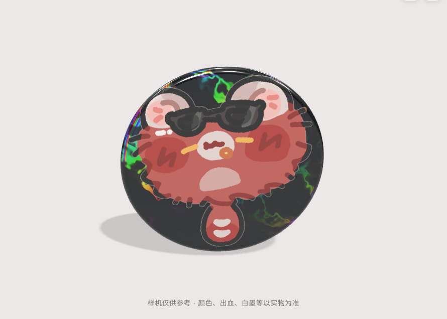 |
| **Book display angle: lying · jacket open** | **Share: site, QR poster, showcase page** |
| 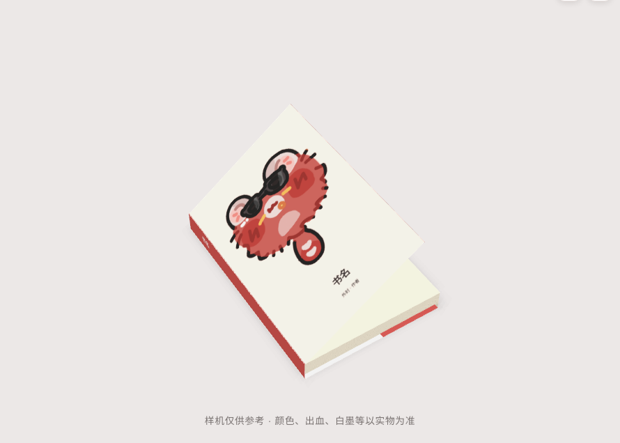 | 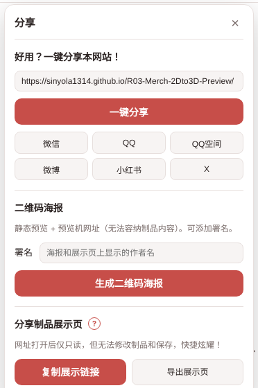 |
| **Exported showcase page (view only)** | |
| 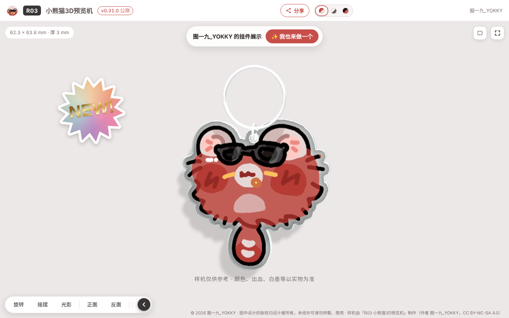 | |

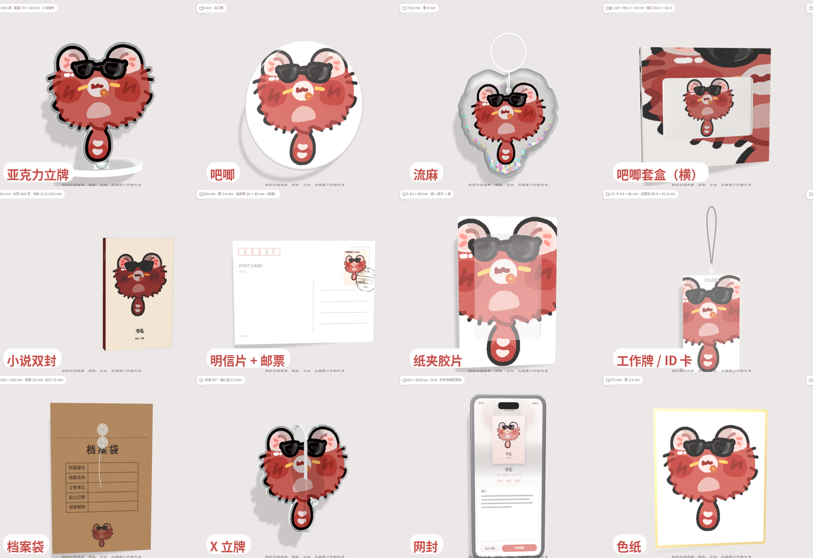

> Everything above was exported directly from the page. The sample character is the author's Yokky Bear. Screenshots show the Chinese interface.

## What it can make

| Category | Items | Main features |
|---|---|---|
| Acrylic | Charm, acrylic stick, quicksand (shaker), clear card, acrylic shikishi, acrylic block, standee, sitting standee, X standee | Auto die line or upload your own; front / back print; adjustable board transparency; custom block size; acrylic shikishi is a clear card with a metallic edge; quicksand can stack several boards; standees with small / background inserts and separate base size and white ink; hole position; ring style, color and size; shakeable quicksand sequins |
| Badge | Round 58 / 75, rectangle 43×70 / 85×55 / 30×85, square 50×50 / 80×80, oval 64×94, coffin 75×45, custom-shape badge (from die line), camera badge (upload die line / emboss map: recessed screen, raised buttons) | Tinplate and plush materials; upload a die line (red = artwork line, black = cut line) for any shape; gloss, matte and holo films |
| Packaging | Badge box, mailer box, paper bag, document envelope, file envelope, binder | Folds a flat die line into a box with folding animation; badge box presets with windows showing the badge inside; paper bags from W × gusset × H, can flatten into a die template and export it, six papers, several handle types, separate front / back / side art; envelopes with string-and-button or snap closures that open and close; binders in A5 / large A5 / B5 / A4 with rings, can lie flat |
| Film | Single frame, film strip, framed film card | 135 (35 mm), wide 50 / 70 mm, 120 medium format 61 mm (no sprockets); color, B&W, muted, Hong Kong film looks; editable edge text (title, frame number, timecode); strips up to 8 frames that roll / unroll with animation; custom sizes; adjustable translucency; black / white / off-white film base; framed card = paper frame + film + paper frame, with uploadable window and outline die lines and foil on the frame |
| Other | Badge holder / ID card, can | Paper frame + image + paper frame, laminated (gloss / matte, adjustable seal and corners); uploadable die lines; slot or round lanyard hole and rings like charms; common sizes 54×86, 86×54, 60×90, 70×100, 80×120. Can: diameter calculated from your artwork's length × height, label wraps around the body, tin lids (rims, ridges, pull tab) in any color, default flat size 240 × 94 mm |
| Web cover (under Book) | Online book cover | 1500×2000 (3:4), 1500×2100 (5:7); flat card (most accurate color), mobile bookstore page (editable title, author, tags, description), 3D book |
| Combo | Badge + backing card, assembly | Backing cards preset to badge sizes, or a custom shape from a die line; assembly lets you arrange checked backing cards / boxes, badges and acrylics freely |
| Paper | Postcard, stamp, hanafuda card, instant-photo card, photocard, shikishi, holo ticket, custom-shape paper, cutout bi-fold, cutout tri-fold, folded leaflet, folding-screen shikishi, sticky notes | Separate front and back; reverse layer on holo tickets; shikishi edge wrap / borderless and finish presets (including gilded), 14×21 cm portrait and landscape; foil / emboss / UV / reverse layers; stamps with perforated or wavy edges and postmarks, placeable on postcards; instant-photo cards fill the whole front; sticky notes that tear off one by one |

General features:

- **Holo base boards**: color porcelain, silk cyan / gold, brushed silver, many holo patterns, bright silver / gold, mica board and more, plus 52 bases made with reference to a printer's swatch book, and flowing textures (abalone, iridescent ripple, white stars, frost, velvet iridescent).
- **Foil swatches**: gold, silver, rose gold, holo, sand, floral, brushed and more, 20 special foils (champagne gold, clear holo, starry holo, aurora, rainbow gradient, mother-of-pearl, etc.), cat's eye and flowing textures. Up to 3 foil layers per side, each with its own opacity.
- **Tassels** (paper, acrylic): a hole with a metal eyelet at the bottom, a jade bead and a silk tassel that sway gently; colors, length, size and position are all adjustable.
- **Rings**: key ring, rectangular / square spring clips, gourd, ball chain, D-ring, star, heart, cat head, bunny, sakura and moon swivel clasps, wire loop, lanyard.
- **White ink density**: 0%, 30%, 50%, 80% and full white presets, or fine-tune; white ink layers can be uploaded.
- **Board color overlay**: solid or gradient colors over the board, with color, angle, opacity and blend mode.
- **Lighting**: presets, direction, strength, color temperature, shadows, plus exposure, contrast, saturation and other filters.
- **Watermarks**: diagonal text, diagonal lines, moiré, tiled images and small watermarks; can be clipped to the print layer.
- **Color mode**: switch RGB / CMYK in the floating ball. CMYK is an approximate print preview applied to the item only.
- **Background**: solid colors, transparent, or your own image (colors kept as in the original), with optional item size, process notes, author and custom text.
- **Canvas text**: add text anywhere in several styles; drag any text or small watermark in the preview, drag corners to scale, works with fingers on phones. Change fonts or upload your own font file (used only on your device).
- **Stickers / slogan watermark / blur bars**: add stickers (including stamps), big slogans like "This is my husband!", or blur / mosaic bars to hide part of the image. All draggable and scalable.
- **Export**: high-res PNG; standard MP4 turntable video (H.264, 24 / 30 / 60 fps, 3:4 / 9:16 / 1:1 / 16:9), or click "Record" and turn it yourself; GIF; animation speed 0.5× / 1× / 1.5× / 2×.
- **Config files**: export all current settings as a JSON file, or copy them as a share link; opening it restores everything (images need to be uploaded again).

### Books

- Perfect binding, sewn perfect binding, saddle stitch, art book, novel (optional dust jacket), hardcover, sewn hardcover, lay-flat hardcover, exposed-spine sewn, spiral, stab binding, accordion (hardcover folding book).
- The gutter curves when open (flatter for sewn and lay-flat); hardcovers have rounded spines; weight estimates per copy and per batch.
- Size presets: A6 pocket, B6, 32mo, large 32mo, A5, B5, 16mo, A4, square 210, or custom.
- Upload interior pages as PDF, covers as PDF (spread / single pages) or images, or use the first and last interior pages as covers.
- Import settings like InDesign: bleed, margins (top / bottom / inside / outside), binding edge (left / right), first page left or right, page range.
- Interior papers listed separately for text books and art books; paper, cover paper and lamination affect spine thickness and feel. Turn pages by hand or automatically, and export page-turning videos.
- **Spine & edges**: spine size and cover spread size calculated from page count and paper; separate spine image; gold, silver, solid or image edge painting; thread color for exposed-spine sewing.
- **Obi band**: upload the band image and a custom die line; coated, matte, tracing or pearl paper; optional flaps; flat length calculated automatically.
- **Novel dust jacket**: take the jacket off and put it back on; foil / emboss / UV / reverse on the jacket; flat length calculated automatically.
- **Display angles**: standing · front, standing · spine, lying · from above, lying · jacket open, with matching pose, light and shadow in one click (works for web covers too).
- **Hardcover details**: board thickness and overhang, hinge grooves near the spine; jacket and obi flaps wrap around the cover edges.
- PDFs are read only in your browser; the PDF reader (pdf.js) is loaded online once.

## How to use

1. Open the page, then read and accept the license.
2. Pick a category and item on the right.
3. Upload your design in "Images". Export multiple layers and die lines on the same canvas size so they line up.
4. Adjust board, white ink, size and lighting.
5. Drag to rotate, then click "Export PNG image" or "Export video", or click "Record" below the canvas and turn it yourself.

A recent version of Chrome or Edge is recommended.

### Sharing mockups

Click "Share" at the top right:

- **Share this site**: click the link to copy it; "Share now" opens your phone's share sheet. In the English interface you can also share to X, Facebook, Reddit, Bluesky and Threads (WeChat, QQ, Weibo and Xiaohongshu are still available).
- **QR code poster**: a portrait image with the page title, your current view, a QR code and "Name's item". The QR code opens the tool (the link can't hold your item). You can add your name.
- **Showcase page**: viewers can look but can't edit or save. Show it off fast!
  - **Copy showcase link**: settings and compressed images go into one link. Bigger images make longer links, which chat apps may cut off; book PDF pages don't fit.
  - **Export showcase page**: a single web page file with the best quality, including book PDF pages. Upload it to cloud storage and share that link.
  - Viewers can rotate, sway, adjust lighting and play animations; the page has a "Make my own" button and a small copyright line. Images are packed into the link or file, so only share designs you have the right to publish.

## Keyboard / mouse shortcuts

**3D view**

- Left-drag: orbit
- Scroll / pinch: zoom
- Right-drag, or Shift / Ctrl + left-drag: pan
- Two-finger drag (touch): pan
- Standee: drag a character / insert to move it on the base (can be turned off in "Base & inserts")
- Assembly: drag a part box / rotate handle to move / rotate parts; hold Shift to move only horizontally or vertically
- Rotation gizmo: drag a ring to turn around that axis; hold Shift for 15° steps

**Canvas text, stickers, blur bars**

- Click: select and open the editor
- Drag: move; drag corners to scale
- Shift-drag: move only horizontally or vertically
- Arrow keys / Shift + arrows: nudge / big step
- Delete or Backspace: delete the selected free text, sticker or blur bar
- Double-click a text box: jump to that text in the list
- Right-click a color swatch: reset to default color

**Guides & rulers**

- Drag from a ruler into the canvas: create a guide (snaps near the center line)
- Drag a guide back to the ruler, or double-click it: delete the guide

**Keyboard**

- Ctrl + Z (Mac: ⌘ + Z): undo
- Ctrl + Shift + Z or Ctrl + Y (Mac: ⌘ + Shift + Z): redo
- Ctrl + K or / (Mac: ⌘ + K): open search
- Right-click a section title (phone: long-press): expand all / collapse all
- Ctrl-click (Mac: ⌘-click) parts in assembly: multi-select
- Ctrl + R (Mac: ⌘ + R): show / hide rulers (no page reload)
- Book: A / D or ← / →: previous / next page
- Enter in the book page box: jump to that page
- Esc: exit fullscreen, close the floating menu, close example images, end tips
- ← / → on the theme buttons: switch interface theme

## How mockups and videos are made

**Mockups**

1. The PNG you upload is read only in your own browser and never uploaded to any server.
2. The tool traces the outline from the PNG's transparent edge, then "extrudes" it to the board thickness. Die lines, rings and glitter are 3D models built the same way.
3. Base, white ink, color print, foil and lamination are stacked layer by layer like the real process. How each layer reflects light, such as holo, sparkle or pearl, is calculated with math, not photos.
4. Your computer or phone's graphics chip (WebGL) draws what you see in real time based on lighting and view.

**Videos**

1. The model turns a little each frame and every frame is drawn.
2. The browser's built-in video encoder compresses the frames to H.264 and packs them into an MP4.

No AI model is used anywhere in the process, and nothing goes online.

**Why the first load takes a few seconds**: the graphics chip compiles the material reflection formulas first. The tool prepares them while you read the license; swatches show images by default and only compile the one you click. Exported videos contain no "AI-generated" marks; if a platform shows one after upload, it usually comes from AI features in editing software used afterwards.

## Roadmap

- **Badges in paper bags**: put badges into a paper bag in assembly.
- **Binder pages**: photocard pocket pages (different pocket counts).
- **Comparison mode**: the same image side by side with different white ink densities or holo bases (performance will be checked first).
- **Atmosphere**: rain and mist effects on lamination.
- Desktop apps for Windows and Mac.
- More of the interface in English.

Plans may change based on feedback.

## License

This tool is licensed under [CC BY-NC-SA 4.0 (Attribution-NonCommercial-ShareAlike 4.0 International)](https://creativecommons.org/licenses/by-nc-sa/4.0/deed.en). See [LICENSE.md](LICENSE.md).

- **You may**: use, copy, share and modify this tool for free.
- **Attribution**: credit the author "囿一九_YOKKY", name the license with a link, and say whether you changed anything.
- **NonCommercial**: except for the original author, no one may sell this tool or a modified version, or include it in anything paid (paid products, courses or services), including as a bonus.
- **ShareAlike**: modified versions must be released under the same license.
- **Your mockups**: the designs in your mockup images and videos are yours. The author claims no rights to them, and you may use them commercially.

The sample character images in the page are © 囿一九_YOKKY and are used only as demos for this tool.

References for holo bases, boards and die cuts come from the internet and real photos. For copyright concerns, please contact the author.

If the Chinese and English versions of this README differ, the Chinese version ([README.md](README.md)) prevails.

### Third-party components

- [three.js](https://threejs.org/) r147, MIT License, Copyright © 2010-2022 three.js authors.
- [mp4-muxer](https://github.com/Vanilagy/mp4-muxer) 5.1.3, MIT License, Copyright © 2023 Vanilagy.
- [qrcode-generator](https://github.com/kazuhikoarase/qrcode-generator) 1.4.4, MIT License, Copyright © 2009 Kazuhiko Arase.
- [Nunito](https://github.com/googlefonts/nunito) (English interface font, Latin subset), SIL Open Font License 1.1, Copyright 2014 The Nunito Project Authors.

## Contributing

Since V1.5.5 the source code is no longer public. You can still help:

- Report problems, share real-product comparison photos, suggest new item types, or improve the English wording: open an [Issue](https://github.com/sinyola1314/R03-Merch-2Dto3D-Preview/issues).
- Developers who'd like to take part, please contact the author first.

## Support the author

This tool is free. If it helped you, you're welcome to support future development:

- Taobao shop "囿酒屋YOSAKE": https://gw25h5o2a7u3apvftc6uzlpt17xwzsc.taobao.com/

## Contributors & sponsors

Thanks to everyone who took part and helped (in order of time; tell the author if you'd rather not be listed):

| Name | Contribution |
|---|---|
| 囿一九_YOKKY | Creator and design |
| 有球印厂 (Youqiu printing) | Holo base / foil swatch references |
| 吧唧吧唧小铺 | Licensed the camera badge 3D mockup, for display only |
| 小祁 | Testing and QA |

Foil colors reference the Zhencai Gold Foil / Jinsui / Xingyu swatch books, laid out by the author.

## Changelog

Recent versions

- **V2.6.3**: standees get a "Character die line" upload under Images (not uploaded = automatic die line); borderless shikishi with an edge line image now folds the bleed outside the red trim line to the back, so the ring on the back shows that part of your artwork instead of a plain border color; the wrap width is measured against the trim line.
- **V2.6.2**: tidier About section in English: the author is shown as YOKKY only, the Chinese social media / group block at the bottom is hidden, and the four buttons have shorter labels that wrap neatly.
- **V2.6.1**: "小熊猫" is now translated as **Yokky Bear** everywhere in the English interface; the English name is now R03 Yokky Bear 3D Previewer.
- **V2.6**: the English interface is now part of the main version, and everything added in V2.5.1–V2.5.12 is translated. Accordion books now show every page (pages past the first few used to stay blank). English interface: switch languages in the first section of Settings ("语言 / Language") or on the license screen; the language follows your browser on first visit and can be forced with `?lang=en` / `?lang=zh`. The English interface uses the Nunito font. In English, X, Facebook, Reddit, Bluesky and Threads are listed first in Share, and feedback links point to GitHub Issues. Added this English README.
- **V2.5.12**: a 2-page cover PDF is now read as front + back cover (3 pages = front, inside front, back; 4 pages = front, inside front, inside back, back); a narrow first page is read as single pages even when "Spread" is chosen. Accordion books show the uploaded back cover, read the back side in the right order, and no longer add a blank page.
- **V2.5.11**: in Assembly, items listed above a half-folded leaflet used as an item are no longer hidden behind its pages.
- **V2.5.10**: in Assembly, dragging an item on the stage re-stacks it by layer order, so copied badges can be brought to the front; a negative height fine-tune no longer sinks an item into the one below; translucent films and acrylic follow layer order.
- **V2.5.9**: the two cutout modes are now strict: "Solid black" cuts only the black areas and keeps white areas enclosed by black; "Line art" cuts everything enclosed by a closed line.
- **V2.5.8**: the Assembly "Layers" panel sits at the top right by default and can be dragged anywhere (position is remembered); click to collapse, double-click to reset.
- **V2.5.7**: "Inner PDF layout" moved next to the inner PDF upload and is visible before uploading.
- **V2.5.6**: books accept InDesign spread PDFs: wide pages are split into left and right pages automatically (bleed only on the outer edges, right-bound order supported).
- **V2.5.5**: the cutout image on folding screen shikishi now covers the whole flat sheet and aligns automatically by canvas size.
- **V2.5.4**: book cutouts on front / back cover (and jacket / inner cover for novels); new "Solid black" cutout mode for dense lace, and better line-art recognition; the two badges in a double-window badge box can be adjusted separately; PNG export resolution (2000–6400 px) with tips on sharper exports and why video looks softer; die-line requirements for every item under "Size & die line"; a "Layers" panel in Assembly with one layer per leaflet page.
- **V2.5.1–V2.5.3**: badge box die template alignment fixed; tracing paper covers; separate jacket paper for novels; anonymous usage statistics (Umami, no cookies, images never uploaded).
- **V2.5**: white ink layer for the back of postcards and other paper items; 24 / 30 / 60 fps for videos and recording; replaying tips now uses the same tips as the first visit; no more white line in the book gutter; a notice while large PDFs load; new "Square 80 ×2" badge box; custom badge boxes can have 1 or 2 windows with uploadable window shapes, also drawn in the exported die line; fixed a graphics warning on some Windows computers.
- **V2.4**: new sticky notes in Paper: square / rectangle / circle / custom shape, size, corners, sheet count, adhesive strip and paper color; up to 10 images used in turn, text on the top sheet; sheets tear off one by one in "Motion", also in videos.
- **V2.0**: reorganized panels with numbered sections in the same order for every item; quick setup questionnaire; up to 3 "My presets" per item saved on your device; search (Ctrl+K or /); export aspect ratio and export preview; badge types regrouped; book flaps, manual spine width and spine effects; canvas text levels; and much more.

The full history (in Chinese) is in [README.md](README.md#更新记录).

---

For more mockups and design tutorials, follow 19:

    Xiaohongshu / Weibo / Bilibili: @囿一九_YOKKY
    X: @Yokky_youyijiu
    Email: yokkytg@foxmail.com
