
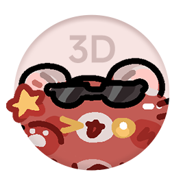

# R03 小熊猫3D预览机

**周边制品2D转3D预览一站式工具箱**

英文名：R03 Merch 2D-to-3D Preview

把 PNG 设计图变成可以旋转查看的周边 3D 样机，支持亚克力、吧唧、纸片、纸盒和组合，色板、水印、背景、文字在「设置」里统一设置。

- **在线使用**：https://sinyola1314.github.io/R03-Merch-2Dto3D-Preview/
- **离线使用**：下载本仓库里的 `index.html`，双击用浏览器打开即可，不需要联网，也不需要安装。
- **当前版本**：v0.31.0（2026-11-12）
- **作者**：囿一九_YOKKY

> 图片只在你自己的浏览器里处理，不会上传到任何服务器。网页也不会保存图片和设置，刷新或关闭后会清空，请及时导出。
>
> 样机效果仅供参考。实际的颜色、出血、白墨等会受厂家设备和批次影响，请以实物为准，作者不承担印刷偏差的责任。

## 公测说明

现在是**公测版 V1.5.5**（V1.0 起公测，之后每次更新都会升版本号，更新内容见文末「更新记录」）。欢迎试用、提意见：

- 常见问题帮助：[【腾讯文档】R03 使用手册](https://docs.qq.com/aio/DSU5jbmpYbU5IWmpk)
- 功能建议、bug 反馈：[【腾讯文档】R03 功能 / bug 反馈](https://docs.qq.com/form/page/DSXhMcFVzek5nRmRs)（网页左上角的版本号也可以直接点开）

也可以在本仓库提交 Issue，或者加 QQ 群反馈：课程咨询群 1132147735（[点击加群](https://qm.qq.com/q/BErLIyPbjO)）、囿酒屋展板预设群 316712262（[点击加群](https://qm.qq.com/q/MoTE0Nga0a)）。反馈时请写上版本号（在网页左上角）。

## 效果预览

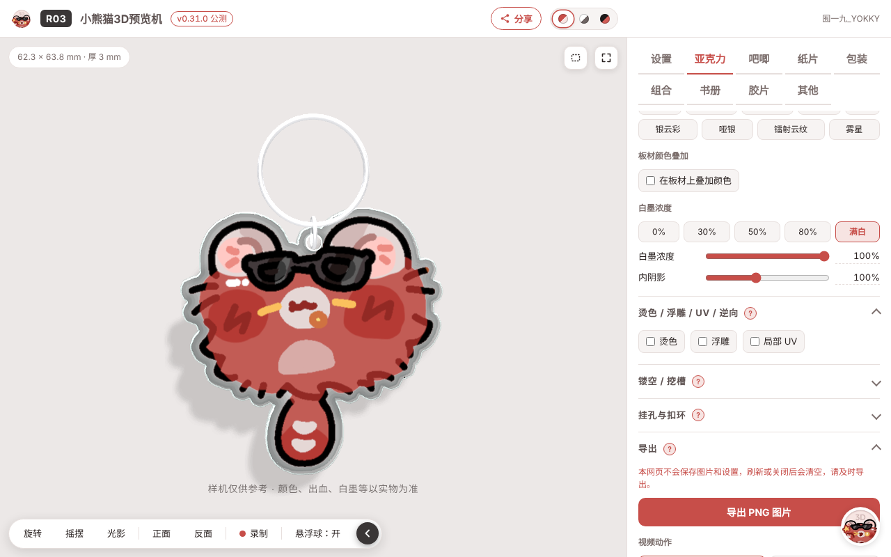

| 亚克力挂件旋转 | 书册翻页 |
|---|---|
| 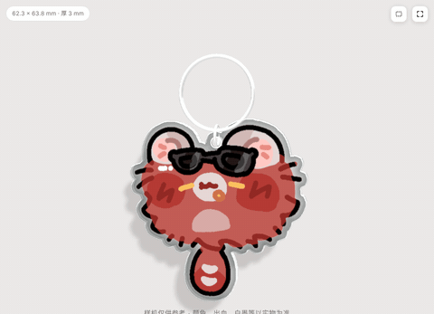 | 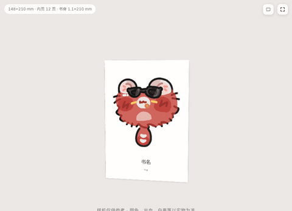 |
| **纸袋从刀模图折成袋子** | **长胶片卷起** |
| 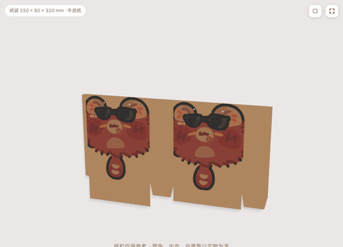 | 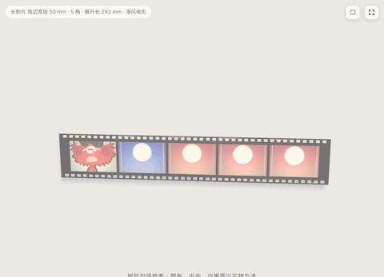 |
| **卡册从平展到合上** | **贴纸、标语水印、邮票** |
| 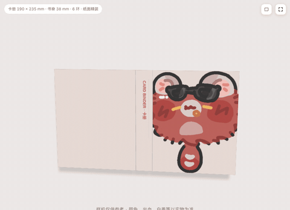 | 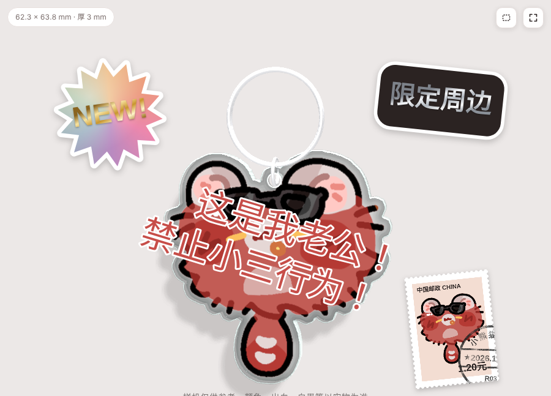 |
| **亚克力挂件 + 挂穗（会轻轻摆动）** | **亚克力色纸（金属色包边）** |
| 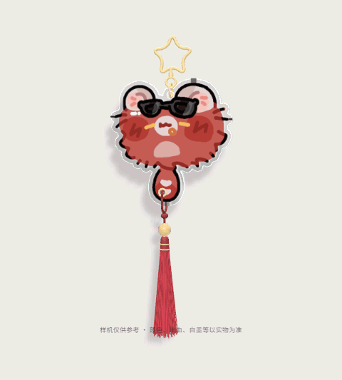 | 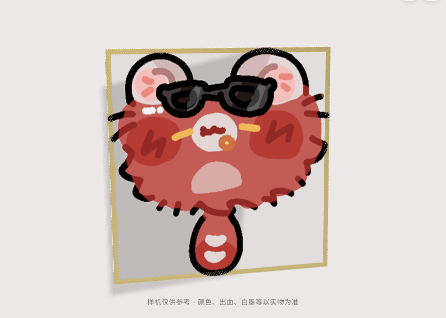 |
| **罐头（罐身图贴一圈，铁皮罐盖）** | **流光纹理闪底（炫彩水波）** |
| 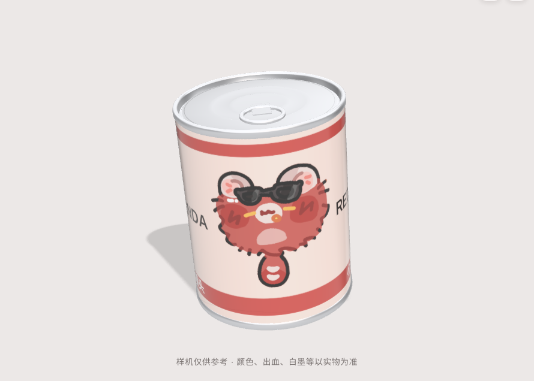 | 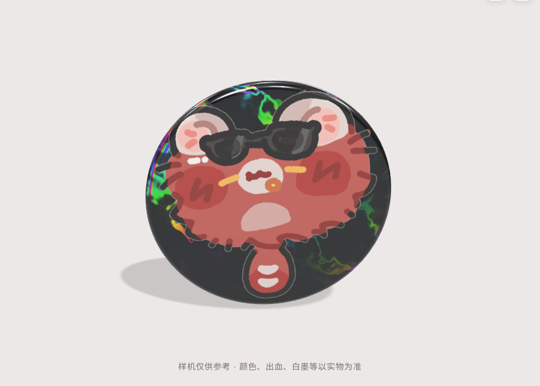 |
| **书册展示角度：平放 · 掀开外封** | **分享：网站、二维码海报、展示页** |
| 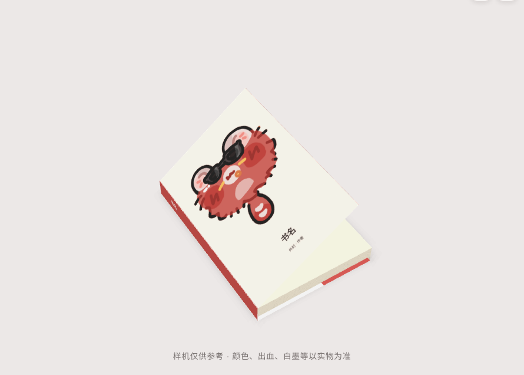 | 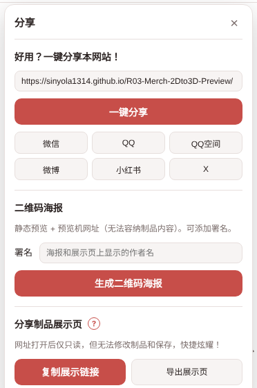 |
| **导出的展示页（只能看，不能改）** | |
| 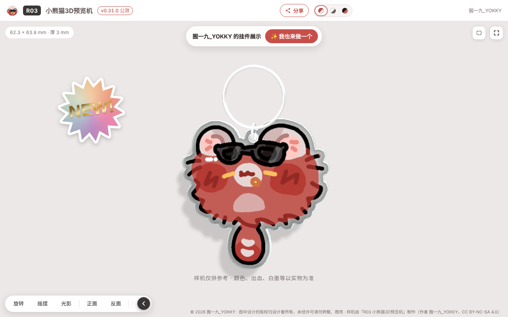 | |

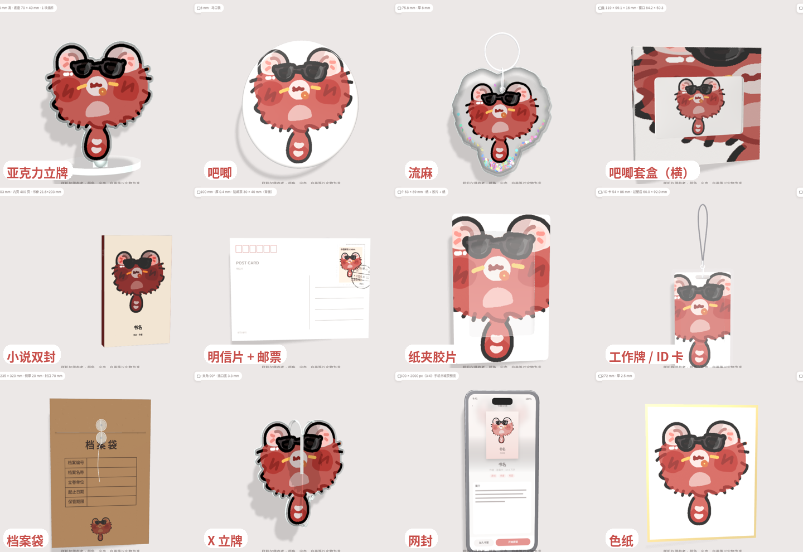

> 以上画面都是用网页直接导出的，示例图是作者的小熊猫。

## 能做什么

| 分类 | 制品 | 主要功能 |
|---|---|---|
| 亚克力 | 挂件、打卡棒、流麻、透卡、亚克力色纸、亚克力砖、立牌、坐姿立牌、X 立牌 | 自动刀线或上传刀线图；正面 / 背面印刷；板材透明度可调；亚克力砖可以自定长宽；亚克力色纸是透卡加一圈金属色包边；流麻可多块板叠放；立牌可加小物插和背景插，底座尺寸和白墨单独设置；挂孔位置；扣环样式、颜色和大小；流麻亮片可以摇动 |
| 吧唧 | 圆形 58 / 75、长方形 43×70 / 85×55 / 30×85、正方形 50×50 / 80×80、椭圆 64×94、棺材板 75×45、异形吧唧（按刀线形状）、相机吧唧（上传刀线 / 凹凸图，屏幕凹陷、按键凸起） | 马口铁和毛绒两种材质；上传刀线图（红线 = 正面画面线，黑线 = 切割线）生成任意形状；亮膜、哑膜、镭射膜 |
| 包装 | 吧唧套盒、飞机盒、纸袋、档案袋、文件袋、卡册 | 按刀线展开图折成盒子，可播放折叠动画；套盒有 58 / 58×2 / 75 / 方 80 / 椭圆 / 长方形（竖版、横版）预设，开窗露出里面的吧唧；纸袋按宽 × 侧宽 × 高生成，可平展成刀模图并导出展开图，六种纸张、纸绳 / 棉绳 / 丝带 / 平口纸提手 / 手提孔，正面、背面、侧面分别放图，工艺可选做在哪几面；档案袋 / 文件袋有侧厚、绕线纽扣或按扣，封口能开合；卡册有 A5 / 大 A5 / B5 / A4 和活页环，可以平展 |
| 胶片 | 单格胶片、长胶片、纸夹胶片 | 135 标准 35 mm、宽版 50 / 70 mm、120 中画幅 61 mm（无齿孔）；彩色、黑白、灰调、港风电影；两侧小字（片名、格号、时间码）可改可关；长胶片最多 8 格，可以卷起 / 展开并播放动画；尺寸可自定义，显示胶片宽、每格画面、建议像素；透光度可调；片基黑 / 白 / 米白；纸夹胶片是纸框 + 胶片 + 纸框，窗口和外形都能上传刀线，烫色做在纸框上 |
| 其他 | 工作牌 / ID 卡、罐头 | 纸框 + 图片 + 纸框，外面整张过塑（亮面 / 哑面膜，封边宽和圆角可调）；窗口和外形可以上传刀线；长条孔或圆孔挂绳孔，可以和挂件一样装扣环（钥匙圈、弹簧扣、挂绳等）；常用尺寸 54×86、86×54、60×90、70×100、80×120；罐头：按设计稿的长 × 高（长边 = 罐身周长）自动算直径，罐身图围着罐身贴一圈，铁皮罐盖（卷边、压纹、易拉环）可改颜色，默认展开 240 × 94 mm |
| 网封（在书册里） | 网络封面 | 1500×2000（3:4）、1500×2100（5:7），平面卡片（颜色最准）、手机书城页（书名、作者、标签、简介可改）、立体书三种展示 |
| 组合 | 吧唧 + 背卡、组装 | 背卡按现有吧唧尺寸预设，也可以上传刀线做异形背卡；组装可以把勾选过的背卡 / 套盒、吧唧、亚克力自由摆在一起 |
| 纸片 | 明信片、邮票、花札牌、拍立得、小卡、色纸、镭射票、异形纸片、镂空双折页、镂空三折页、折页、屏风色纸 | 正反面分别设置；镭射票逆向层；色纸包边 / 无边和工艺预设（含鎏金），14×21 cm 横竖预设；烫色 / 浮雕 / UV / 逆向层；邮票齿孔 / 波浪模切边和邮戳，邮票可以贴在明信片正面或背面；拍立得正面直接铺满 |

通用功能：

- **闪底板材**：彩瓷、蚕丝青、蚕丝金、拉丝银、镭射细雨、镭射碎玻璃、镭射斜光柱、镭射细沙、亮银、亮金、幻彩蛇皮纹、十字镭射、素面镭射、银葱、珠光幻彩蓝、珠光幻彩紫、镭射火焰、反光白、反光银、银云纹、云母板等，另有参考有球印厂样册制作的 52 款闪底，以及流光纹理（鲍鱼贝、炫彩水波、白星、冰霜、丝绒幻彩）。
- **烫色色卡**：金、银、玫瑰金、镭射、流沙、碎花、拉丝等常用烫色，另有香槟金、透明镭射、星空镭射、极光幻彩、七彩渐变、贝母珠光等 20 款特色烫色，猫眼、流光纹理（鲍鱼贝、炫彩水波、白星、冰霜、丝绒幻彩）；一面最多 3 个烫色层，每层可单独调透明度。
- **挂穗**（纸片、亚克力）：底部打孔带金属鸡眼，挂玉石珠子和丝线穗子，会轻轻摆动；穗子、挂绳、珠子、鸡眼颜色和长度、大小、位置都能调。
- **扣环**：钥匙圈、长方 / 方形弹簧扣、葫芦形、珠链、D 字扣，星星、爱心、猫头、兔子、樱花、月亮转环扣，钢丝圈、挂绳。
- **白墨浓度**：0%、30%、50%、80%、满白五档，也可以细调；支持上传白墨图。
- **板材颜色叠加**：纯色或渐变叠在板材上，可调颜色、角度、不透明度和混合方式。
- **光影**：打光预设、方向、强度、色温、阴影，以及曝光、对比度、饱和度等滤镜。
- **水印**：斜纹文字、斜线、摩尔纹、图片平铺和小水印，可以剪贴到印刷层。
- **颜色模式**：悬浮球里切换 RGB / CMYK，CMYK 是近似的印刷预览，只作用在制品上。
- **背景**：纯色（含灰黑色）、透明、自定义图片（颜色和原图一致），可以加制品尺寸、工艺说明、作者和自定义文字。
- **画面文字**：可以在任意位置添加文字，有标签、纯文字、白底、阴影四种样式；所有文字和小水印都能在预览区直接拖动，拖四个角缩放，手机上用手指也能拖。可以换字体，也可以上传自己的字体文件（只在本机使用）。
- **贴纸 / 标语水印 / 模糊条**：在「设置」里给画面加贴纸（含邮票）、「这是我老公！禁止小三行为！」这类大字标语，或者用模糊条、马赛克挡住一部分画面，都可以直接拖动和缩放。
- **导出**：高清 PNG 图片；标准 MP4 旋转视频（H.264、30 帧，可选 3:4 / 9:16 / 1:1 / 16:9），也可以点「录制」自己转动后导出（同样按所选比例）；GIF 动图；动画速度 0.5× / 1× / 1.5× / 2×。
- **配置文件**：把当前所有设置导出成一个 JSON 文件，或者复制成分享链接直接发给别人，对方打开就能还原（图片需要重新上传）。

### 书册

- 无线胶装、锁线胶装、骑马钉、画册、小说（可选内外双封）、精装（胶装）、锁线精装、蝴蝶精装、裸脊锁线、线圈本、线装本、经折（精装折页）。
- 翻开时中缝会弯下去（锁线、蝴蝶装更平），精装是圆脊；可以估算单本和整批的重量。
- 尺寸预设：A6 文库、B6、32 开、大 32 开、A5、B5、16 开、A4、方 210，也可以自定。
- 内页上传 PDF，封面上传 PDF（展开图 / 单页）或图片，也可以直接用内页的首尾页做封面。
- 导入设置参考 InDesign：出血、版心边距（上 / 下 / 内 / 外）、装订边（左 / 右）、第一页在左还是右、页面范围。
- 内页纸按文本册 / 画册分开列：米白 / 本白道林（80 / 100 / 120g）、双胶、欧维斯、蒙肯纸；画册用铜版、哑粉、超感、欧维斯。纸张、封面纸、覆膜会影响书脊厚度和质感；可以手动翻页、自动翻页，导出翻页视频。
- **书脊与刷边**：按页数、纸张自动算出书脊宽高和封面展开尺寸；可以单独上传书脊图；书口可以刷金、刷银、纯色或用图片；裸脊锁线可以换锁线颜色。
- **腰封**：上传腰封图和异形刀线，选铜版 / 哑粉 / 硫酸纸 / 珠光纸，勒口可有可无；自动算出腰封展开长度（封底 + 书脊 + 封面 + 勒口）。
- **小说双封**：外封可以「脱下 / 穿上」，脱下后露出内封再翻内页；外封可以加烫色 / 浮雕 / UV / 逆向层，自动算出外封展开长度。
- **展示角度**：立放 · 正面、立放 · 看书脊、平放 · 斜上方、平放 · 掀开外封，一键换好摆放、光和影子（网封也能用）。
- **精装细节**：硬壳板有厚度和飘口，靠书脊有书槽；外封、腰封的勒口绕过封面边缘折进去。
- PDF 只在浏览器里读取，需要联网加载一次 PDF 读取组件（pdf.js）。

## 怎么用

1. 打开网页，阅读并同意授权协议。
2. 在右侧选择分类和制品。
3. 在「图片」里上传你的设计图。多个图层和刀线图请用同一画布尺寸导出，才能对齐。
4. 调整板材、白墨、尺寸和光影。
5. 拖动旋转查看，点击「导出 PNG 图片」或「导出旋转视频」，或者点画面下方的「录制」自己转动。

建议使用新版 Chrome 或 Edge 浏览器。

### 分享样机

点网页右上角的「分享」：

- **好用？一键分享本网站！**：点网址直接复制；手机上「一键分享」会弹出系统分享面板；也可以分享到微信（扫码）、QQ、QQ 空间、微博、小红书（复制文案）、X。
- **二维码海报**：一张竖版图片，上面是网页标题，中间是当前画面，下面是二维码和「XX 的 制品名」。二维码打开的是工具网站（链接太长，装不下制品内容），可以加署名。
- **分享制品展示页**：别人打开后只能看、不能修改和保存，快捷炫耀！
  - **复制展示链接**：设置和压缩过的图片放进一条链接里，图片越大链接越长，聊天软件可能会截断太长的链接；书册的 PDF 内页放不进链接。
  - **导出展示页**：一个网页文件，画质最好，书册 PDF 内页也能带上，传到网盘再分享网盘链接。
  - 展示页能旋转、摇摆、调光影、播放动画，有「我也来做一个」按钮和版权小字。图片会打包进链接或文件里，请只分享你有权公开的设计。

## 键盘 / 鼠标快捷键

**3D 画面**

- 左键拖动：旋转视角
- 滚轮 / 双指捏合：放大缩小
- 右键拖动，或按住 Shift / Ctrl 再左键拖动：平移画面
- 双指拖动（触屏）：平移画面
- 立牌：按住人物 / 插件拖动：在底座上换位置（「底座与插件」里可关）
- 组装：拖动零件框 / 旋转把手：移动 / 旋转零件，按住 Shift 只沿水平或竖直方向移动
- 旋转轴（摆正工具）：拖动圆环：绕这条轴转动，按住 Shift 每次转 15°

**画面上的文字、贴纸、模糊条**

- 点一下：选中，并弹出编辑框
- 拖动：移动；拖四个角缩放
- 按住 Shift 拖动：只沿水平或竖直方向移动
- 方向键 / Shift + 方向键：微调位置 / 大步移动
- Delete 或 Backspace：删除选中的自由文字、贴纸、模糊条
- 双击文字框：跳到下面列表里对应的文字
- 右键颜色块：恢复默认颜色

**参考线和标尺**

- 从标尺往画面里拖：拉出参考线（靠近中线会自动吸附）
- 把参考线拖回标尺，或双击参考线：删除参考线

**键盘**

- Ctrl + Z（Mac：⌘ + Z）：撤销
- Ctrl + R（Mac：⌘ + R）：显示 / 隐藏标尺（不会刷新网页）
- 书册：A / D 或 ← / →：往前 / 往后翻页
- 书册页码框里按 Enter：跳到这一页
- Esc：退出全屏、关闭悬浮球菜单、关闭示例图、结束新手提示
- 界面配色按钮上按 ← / →：切换界面配色

## 样机和视频是怎么做出来的

**样机原理**

1. 你上传的 PNG 只在你自己的浏览器里读取，不会上传到任何服务器。
2. 工具按 PNG 的透明边缘描出外形，再按板厚「拉」成立体的板子。刀线、扣环、闪粉也都是这样搭出来的 3D 模型。
3. 底材、白墨、彩印、烫色、覆膜像真实工艺一样一层层叠起来。每一层怎么反光，比如镭射、闪底、珠光，是用数学公式算出来的，不是贴照片。
4. 用电脑或手机的显卡（WebGL）按灯光和视角，实时画出你看到的画面。

**视频原理**

1. 让模型每一帧转一点点，把画面一张张画出来。
2. 用浏览器自带的视频编码功能，把这些画面压成 H.264 格式，再打包成 MP4。

整个过程没有用到任何 AI 模型，也不联网。

**为什么第一次打开要等几秒**：显卡要先把材质的反光公式编译一遍。工具会在你看协议的时候提前准备，色卡默认只显示图片，点了哪个才编译哪个。导出的视频里也不会写入任何「AI 生成」标记；如果上传平台后出现这类提示，通常来自之后使用的剪辑软件的 AI 功能。

## 后续更新计划

- **纸袋装吧唧**：组装时把吧唧放进纸袋里。
- **卡册内页**：活页小卡内页（不同格数）。
- **对比模式**：同一张图并排显示多种白墨浓度或多种闪底（会先评估性能，卡顿就换方案）。
- **氛围**：覆膜增加雨雾效果。
- 保存常用预设。
- 打包成 Windows 和 Mac 桌面软件。

计划可能会根据大家的反馈调整。

## 授权协议

本工具采用 [CC BY-NC-SA 4.0（署名-非商业性使用-相同方式共享 4.0 国际）](https://creativecommons.org/licenses/by-nc-sa/4.0/deed.zh-hans) 授权，详见 [LICENSE.md](LICENSE.md)。

- **可以**：免费使用、复制、分发和修改本工具。
- **署名**：注明作者「囿一九_YOKKY」、协议名称和链接，并说明是否做过修改。
- **非商业性使用**：除原作者外，任何人不得出售本工具或修改版，也不得把它作为收费项目（付费产品、付费课程、付费服务）的一部分或赠品。
- **相同方式共享**：修改版必须以同样的协议发布。
- **关于你做的样机**：样机图片和视频里是你自己的设计，作者不对其主张权利，你可以把它们用于商业用途。

网页内的示例角色图版权归 囿一九_YOKKY 所有，仅作为本工具的演示图使用。

闪底、板材、模切的参考来自互联网和实拍图，如遇版权问题，请联系作者沟通。

### 第三方组件

- [three.js](https://threejs.org/) r147，MIT License，Copyright © 2010-2022 three.js authors。
- [mp4-muxer](https://github.com/Vanilagy/mp4-muxer) 5.1.3，MIT License，Copyright © 2023 Vanilagy。
- [qrcode-generator](https://github.com/kazuhikoarase/qrcode-generator) 1.4.4，MIT License，Copyright © 2009 Kazuhiko Arase。

## 问题反馈

- 常见问题帮助：[【腾讯文档】R03 使用手册](https://docs.qq.com/aio/DSU5jbmpYbU5IWmpk)
- 功能建议、bug 反馈：[【腾讯文档】R03 功能 / bug 反馈](https://docs.qq.com/form/page/DSXhMcFVzek5nRmRs)
- 也可以在本仓库提交 Issue，或者[点击加入 QQ 咨询群（1132147735）](https://qm.qq.com/q/BErLIyPbjO)反馈。

## 一起完善

从 V1.5.5 起，本工具不再公开源代码。欢迎这样参与：

- 反馈问题、提供制品实拍对比图、建议新的制品类型：在本仓库提交 Issue，或者加 QQ 咨询群（1132147735）。
- 会写代码、想参与开发的朋友，可以先在群里联系作者。

## 支持作者

本工具免费使用。如果它帮到了你，欢迎通过以下方式支持后续开发：

- 淘宝店铺「囿酒屋YOSAKE」：https://gw25h5o2a7u3apvftc6uzlpt17xwzsc.taobao.com/

## 贡献者与赞助者

感谢每一位参与和支持的朋友（按时间顺序，如不希望署名请告诉作者）：

| 名称 | 贡献 |
|---|---|
| 囿一九_YOKKY | 发起与设计 |
| 有球印厂 | 闪底 / 烫色色卡参考 |
| 吧唧吧唧小铺 | 授权相机吧唧 3D 样机制作，仅作效果展示 |
| 小祁 | 测试和 QA 帮助 |

烫色颜色参考臻彩金箔 / 金穗 / 星宇样册，由作者排版。

## 更新记录

点开查看各版本更新

- **V1.5.5**：从这个版本起不再公开源代码，仓库只保留网页文件和说明；网页里的程序代码做了压缩。
- **V1.5.4**：吧唧套盒的横竖方向可以分开调：「整个盒子转 90°」把做好的盒子换个方向摆（刀模和印刷图不变）；盒里的吧唧可以选跟窗口、原方向、顺时针 90°、180°、逆时针 90°；悬浮球里的横竖颠倒改成三选一（整个盒子 / 盒里吧唧 / 盒子宽高互换，上传了刀模时不显示宽高互换）。
- **V1.5.3**：亚克力砖新增「自定长宽」：宽、高分别调（20–300 mm），带 80×80、100×100、60×90、90×60、80×120、120×80 预设；图片可选完整放进去、铺满（裁边）或拉伸铺满。
- **V1.5.2**：修复穗子颜色偏亮偏白（颜色换算问题），现在和选的颜色一致；加了挂穗后自动重新取景，制品和穗子一起放在画面中间；挂穗区块新增「画面上下」可以手动挪位置；摆动幅度旁加提示：摆动时画面一直刷新，对性能要求高、比较耗电。
- **V1.5.1**：挂穗重做：穗子改成一根根丝线（往下微微散开，长短参差，带丝光），穗头是一圈圈缠线加两道金线箍；挂绳单独选颜色（深红、金、黑、米白或和穗子一样），做成两股拧绳的纹理，从正面穿过孔、绕过底边回到绳结，是一根连续的绳子，接口不再断开；珠子改成玉石质感（云絮状深浅和细纹，带光泽）；挂穗会轻轻摆动，转动、摇摆制品时会被带着甩起来再慢慢停下，「摆动幅度」可调（0 为不动）。
- **V1.5**：烫色色卡和板材（闪底）新增「流光纹理」一类：鲍鱼贝、炫彩水波、白星、冰霜、丝绒幻彩（参考进口烫印膜样册的效果画的程序纹理，不含样册照片）。纸片和亚克力新增「挂穗」：底部打孔（带金属鸡眼），绳子穿孔挂一颗珠子和一束穗子，像玉佩的穗子；穗子、珠子、鸡眼颜色，穗子长度，珠子大小，孔径和孔的位置都能调（立牌类和会翻折的纸片除外）。
- **V1.4.2**：二维码海报重新排版：作者写在右上角；主标题「XX 的 制品名」放大；下面一行写尺寸和材质；二维码缩小，改成偏棕的深灰色。
- **V1.4.1**：分享面板重新整理成三段（一键分享本网站 / 二维码海报 / 分享制品展示页），说明文字精简，展示链接和展示页的详细介绍收进「?」里；去掉「复制链接」按钮，点网址就能复制；新增分享到微信（扫码）、QQ、QQ 空间、微博、小红书（复制文案）、X；按钮间距加大，不再挤在一起。
- **V1.4**：分享新增「二维码海报」：一张竖版图片，最上面是网页标题栏，中间是当前预览区的画面，最下面是二维码和标题，扫码打开工具网站，适合发到社交平台；填了署名会写在海报上。
- **V1.3.3**：罐头的「高度」改成罐身高（印刷图铺满整个罐身，上下卷边另算），展开图 = 周长 × 罐身高；新增「展开图长边」滑杆，按设计稿的长边调，自动算出直径（直径 = 长边 ÷ π），改直径也会同步长边；默认预设改为展开 240 × 94 mm。
- **V1.3.2**：新手教学精简。
- **V1.3.1**：亚克力（含立牌、坐姿立牌、X 立牌）新增「板材透明度」：板子本身和底下的板材（闪底）一起变透，加了闪底也不会像垫了白底；亚克力色纸默认 55%。罐头新增「标签 240×94」预设（罐身图 240 × 94 mm，直径约 76.4 mm、高 108 mm），并设为默认；修复罐头顶部和底部从上下看是透明的问题；罐头不再显示通用的「尺寸」区块和白墨层上传。
- **V1.3**：亚克力新增「亚克力色纸」：透卡加一圈金属色包边（正面 + 侧边 + 背面，或只做侧边），板子更透、内阴影更淡，包边宽度和颜色可调。「其他」新增「罐头」：上传一张长方形展开图，围着罐身贴一圈（面板里会算好展开尺寸和像素），上下是铁皮罐盖（卷边、一圈圈压纹、易拉环），不放图片、颜色可改（银、金、玫瑰金、黑、白等，金属光泽或哑光涂装），标签可选亮面 / 哑面 / 纸质，常见尺寸一键切换。网封也能用「展示角度」（立放 · 正面、立放 · 看书脊、平放 · 斜上方）。修复上传背景图后颜色变灰、白色变浅灰的问题：高光柔和压缩现在只作用在制品上，背景图和纯色背景保持原来的颜色（白底就是纯白）。
- **V1.2.1**：细节优化。
- **V1.2**：书册新增「展示角度」（参考实拍样机）：立放 · 正面、立放 · 看书脊、平放 · 斜上方、平放 · 掀开外封，一键换好摆放、光的方向和影子；平放时书躺在桌面上，点「旋转」会在桌面上转圈，翻开也是平摊在桌上。小说外封可以用「掀开外封」滑杆掀起正面，露出里面的内封。精装书的硬壳板有了厚度（书口和上下切口能看到板边），板比书芯大一圈的飘口更明显，封面、封底靠书脊处加了书槽（压出的凹槽）。外封和腰封的勒口改成绕过封面边缘折进封面里面，书口处有圆弧折边。
- **V1.1**：卡册内页改成夹在内环上、在封面和封底之间均匀散开，侧着能看见一点内页内容，可调「内页散开」。光影新增「滤镜只影响制品」，背景不跟着变色；悬浮球新增「RGB / CMYK」颜色模式切换，CMYK 是近似的印刷预览（只作用在制品上，太艳的颜色会变灰一些），画面上方显示当前模式。手机上：预览区和调整区之间可以拖动分隔条改大小（电脑上左右也能拖，双击复原），调整区右边多留空、滑块缩短，滑动调整区时顶部不会被带走；导出图片 / 视频改成先弹出保存面板（长按图片保存、下载、系统分享），微信等内置浏览器会提示用浏览器打开。修复导入书封后书脊和封面之间有一条白线的问题。「动画速度」新增 0.5× / 1× / 1.5× / 2× 快捷按钮，视频时长新增 12 秒（慢）。拍立得不再自动留白边，正面图和明信片一样铺满整张（相片框直接画在图里）。修复手动录制不按所选视频比例的问题：现在手动录制也按选的比例（3:4、9:16、1:1、16:9）录，画面上用红色虚线框出录到的范围；选「跟随画面」录整个画面。
- **V1.0（公测）**：版本号改为 V1.0，之后从这里往后编号；分享新增「复制展示链接」，不用导出文件，对方点开链接就能看只读的 3D 展示；展示页底部工具栏去掉多余的分隔线；吧唧新增「无白墨处印刷可见度」，没做白墨的地方闪底会透出来，但印刷还能看见一部分（默认 35%，可调）；异形吧唧和相机吧唧加了「看示例图」，异形吧唧说明有刀线 / 没刀线时正面图的不同要求（有刀线导出整个画布含出血；没刀线默认图里含至少 3 mm 出血，可调「出血外扩」）；相机吧唧默认换成色块示例图和示例白墨层（机身 50%，屏幕和按键 100%）；关于页加上使用手册和功能 / bug 反馈表；烫色一面最多 3 个烫色层，每层单独选色卡（所有带烫色的制品统一）；烫色色卡新增「猫眼」类：祖母绿、星河蓝、紫晶猫眼；立牌底座新增「底座刀线」，修复按底座图形状时底座图不印刷；吧唧套盒新增「去修改盒里的吧唧」，改完一键回到套盒；「样机仅供参考」文字可以改；新手提示里单独介绍区块标题旁的小圆圈说明；全站统一叫法：刀线（黑线）、出血线（红线）、白墨层、背面图等；屏风色纸注明内封、外封、勒口为作者自定叫法。组合里用到的制品改了以后，画面上方会提示「改动已同步到：…」；修复吧唧在组装、套盒里不同步闪底微调、白墨、无白墨处印刷可见度、渐变和烫色的问题；光影调柔：补光改成不会打出刺眼高光点的柔和补光，高光不再一片死白，各光影预设整体稍微调暗。组装里复制出来的每一份、吧唧 + 背卡上的每个吧唧都能「单独调整」：打开和原制品一样的调整页，改完点「完成」回到组合，没单独调整的继续跟原制品同步；立牌、坐姿立牌、X 立牌、胶片、纸夹胶片、工作牌也能勾「这是包装内的物品」放进组装；立牌的人物和插件可以在画面上直接拖动摆放，插槽跟着移动，人物也加了位置滑块；花札、镭射票新增滚边（金 / 银 / 纯色）；所有制品的功能区统一按「图片 → 印刷工艺 → 制品专属设置 → 尺寸 → 板材与白墨 → 材质与表面 → 烫色 / 浮雕 / UV / 逆向 → 镂空 / 挖槽 → 挂孔与扣环 → 动作」排列。单独调整时左上角改成醒目的提示条，带「✓ 完成，回到…」按钮；胶片新增「胶片投影」：主光穿过胶片，把胶片的颜色投在墙上或地面，可调浓度、柔和程度和离墙距离，投影跟着光源和胶片角度变化。进入胶片页时默认换成侧光，投影更明显，离开时自动换回原来的光影。刀线识别改进：按线条中线算形状，线画粗了、画细了成品大小都不变；大图里很细的线（缩小后会变淡的）也能认出来，不会再断开导致切割失败。README 和「关于」里新增键盘 / 鼠标快捷键说明。修复吧唧、纸片等的投影只有一圈边的问题，现在影子是实心的。包装类（吧唧套盒、飞机盒、纸袋、档案袋、文件袋、卡册）新增「刀模图（厂家刀线）」上传，按刀模外框把外面图对齐到展开图上，并加了「完整显示 / 铺满、缩放、左右、上下、旋转」调整；吧唧套盒新增「自定义尺寸」（宽、高、侧厚、矩形 / 圆 / 椭圆窗口或不开窗，盒里的吧唧自动按窗口挑）；修复厚书书口显示成黑色宽条的问题；书册默认光影改成斜前方，影子能看见了。多个烫色层可以分别调透明度；悬浮球菜单最上面新增「横竖颠倒（宽高互换）」，横着设计的图一键换成横版尺寸；打开网页默认先进「设置」页，新手提示跟着调整。书册全部加上「烫色 / 浮雕 / UV / 逆向」，可以选做在封面、封底或两面（封面层和封底层分别上传，和封面 / 封底单页图同一画布）；小说双封可以选做在外封还是内封。修复书册加了工艺后颜色变深、小说外封颜色偏深的问题；书册的影子更柔和，外封、腰封的书脊转角改成小圆角；卡册新增内页（纸内页 / 透明卡套，最多 12 张，内页图铺满整张，靠书脊一侧自动打孔）。
- **v0.31.0**：网页顶部新增「分享」：一键分享网站链接，或导出「展示页」（只能看、不能改的 3D 展示网页，能旋转、摇摆、调光影、播放动画，带「我也来做一个」按钮和版权小字）；吧唧套盒新增长方形横版预设（竖版保留）；色纸新增 14×21 cm、21×14 cm 尺寸预设（不含出血），色纸工艺可选包边 / 无边（包边折到背面）/ 不包边；工作牌 / ID 卡可以和挂件一样装扣环；公测准备：README 加上效果预览动图和截图。
- **v0.30.0**：新增「其他」大类和「工作牌 / ID 卡」（纸框 + 图片 + 纸框 + 塑封膜，挂绳孔可选）；关于页和说明里的广告更新（周边设计课咨询群、囿酒屋 yosake 展板预设群）。
- **v0.29.0**：胶片显示尺寸数据（胶片宽含黑边、每格画面、建议像素、总长），「尺寸」区块可以自定义胶片宽、画面宽高、格间隔和齿孔；胶片半透明、透光度可调；片基颜色预设黑、白、米白；新增「纸夹胶片」（纸 + 胶片 + 纸，默认圆角矩形和自动窗口，可上传窗口刀线、外形刀线、胶片图和胶片刀线，纸框宽度太窄会提醒）。
- **v0.28.0**：新增「胶片」大类（单格胶片、长胶片）；光影新增氛围前景：下雨（雨丝）和流星，会动，导出视频也有；网封合并到「书册」里；分类按钮重新排序，「组合」放在第二行第一个；小说改名「小说 · 无线胶装（双封）」；贴纸的镭射去掉斜条纹并可以叠底色，贴纸文字可以左 / 中 / 右对齐、可以烫金 / 烫银 / 玫瑰金 / 镭射；标语水印可以设置对齐。
- **v0.27.0**：「设置」新增贴纸（圆形、标签、爆炸、爱心、对话框、邮票；纯色 / 渐变 / 镭射，可写字，拖动和缩放）、标语水印（这是我老公！/ 这是我老婆！/ 这是我产品！，可改字、颜色、描边、角度）、模糊条（模糊或马赛克，拖动改位置和宽高，导出时生效）；包装里所有制品都能勾「这是组合的包装」，吧唧、亚克力、纸片能勾「这是包装内的物品（组合）」；悬浮球「一键复位」会按当前朝向摆正成正面或背面正视并居中；书册翻页可以输入页码立即翻到，页码标注按真实页码显示。
- **v0.26.0**：包装新增「卡册」：A5、大 A5、B5、A4 常见尺寸（外壳参考值，可手动改），书脊宽、板厚、活页环数和环直径可调，纸面精装 / PU 皮面 / 绒面，封面、书脊、封底分别放图或整张展开图，可以完全平展同时看到封底、书脊和封面（暂不含内页）。
- **v0.25.1**：悬浮球加「一键复位到正中间」（保持正面或背面的视角）；网封的手机书城页可以改简介，网封页去掉「尺寸」区块、尺寸改在「网封展示」里选；纸袋侧面可以上传图片（两侧可以不同）。
- **v0.25.0**：新增「网封」大类（平面卡片 / 手机书城页 / 立体书）；「纸盒」改名「包装」，新增纸袋、档案袋、文件袋；书册封面上传图片后铺满整个封面（宽图按封底 + 书脊 + 封面切开），小说的外封正面图、外封展开图、内封分开上传并写清楚位置；厚书翻开时页面从书脊根部弯上来，修复中缝露白和翻页时中间的怪异效果。
- **v0.24.0**：纸片新增「邮票」：常见尺寸预设（30×40、40×30、26×31、30×50、50×30、30×60、40×40、60×80），上传矩形图自动加邮票边——齿孔（可调齿孔度数和孔径）、波浪模切、直边或按刀线图，可调白边、画面底色和国名 / 面值文字；新增「邮戳」：日戳、日戳 + 波浪、波浪线、方框戳或上传图片，六种常用印油颜色和自定义颜色，带印油颗粒和斑驳，可移出邮票范围；明信片新增「贴邮票」，可贴在正面或背面，邮戳超出邮票的部分会盖在明信片上。
- **v0.23.0**：新增「小说」书册（默认较厚，可选内外双封，外封能脱下、能做烫色 / 浮雕 / UV / 逆向）；新增「书脊与刷边」（自动算书脊和封面展开尺寸、书脊图、金 / 银 / 纯色 / 图片刷边）和「腰封」（异形刀线、四种纸材、可选勒口、自动算展开长度）；裸脊锁线按真实锁线针脚重画，可换线色；修复书册内页中缝的条纹；修复立牌、坐姿立牌、X 立牌的镂空 / 挖槽不生效，挖槽可多选正面 / 背面，X 立牌和坐姿立牌可多选做在哪几片上；坐姿立牌和 X 立牌加倒塌风险提示；新功能加新手指引；首次打开的协议页加 GitHub 收藏入口。
- **v0.22.0**：书册新增锁线胶装、锁线精装、蝴蝶精装、裸脊锁线、线装本、经折、画册；内页纸按文本册 / 画册重排（道林、双胶、欧维斯、蒙肯、铜版、哑粉、超感）；中缝弯曲、精装圆脊；重量估计；A / D 或左右键翻页；书册默认用正前方柔光；光影新增底光；新增坐姿立牌（桌边摆放 / 背景板组合）和 X 立牌（自动算插口宽度）；撤回改为一次连续操作算一步、最多连续撤回 5 步；悬浮球临时跳到设置后，「本页」仍是原来的制品页。
- **v0.21.0**：新增「书册」大类（平装、骑马钉、精装、线圈本）：内页 / 封面可导入 PDF，参考 InDesign 设置成品尺寸、出血、版心边距、装订边和起始页，常见书本和同人本尺寸、内页纸和封面纸、覆膜，可翻页和自动翻页，导出视频可选「翻折 / 翻页」；「设置 › 排版辅助」新增旋转三轴，拖圆环让制品绕 X / Y / Z 轴转；纸片横版 / 竖版改为整个制品转 90°；亚克力和流麻的背板图印在最背面、白墨垫在朝正面一侧；立牌可估算倒塌风险并给出调整建议（仅供参考）；自动刀线可导出刀线 PNG（画布同正面图）；尺寸标注文字处线条断开、去掉白底；修复新手提示在收起区块里只压暗不圈出的问题。
- **v0.20.0**：改名「R03 小熊猫3D预览机」；首次打开更顺：3D 场景在协议页后面提前准备（准备好会提示「已就绪」），着色程序只编译用到的部分，画面静止时暂停重画；闪底、烫色色卡按效果分类排序；色卡默认用图片预览，点了才做成 3D（可在「设置 › 加载与性能」改成全部 3D）；修复纸片横版 / 竖版切换无效；扣环去掉龙虾扣、方形钥匙扣、大猫猫、小猫。
- **v0.19.1**：关于里新增「样机和视频是怎么做出来的」「素材来源与版权」两个折叠说明；README 加入原理说明。
- **v0.19.0**：参考有球印厂样册制作 52 款 3D 闪底；新增 20 款特色烫色；扣环扩充到 18 种（钥匙圈、弹簧扣、龙虾扣、D 字扣、各种造型转环扣、钢丝圈、挂绳），开口圈不再插进亚克力里；流麻新增小雪花，「铺满画面」时加一层细闪砂，几乎填满流麻腔；细闪粉打开更快。
- **v0.18.0**：改名「R03 小熊猫3D预览机」，标语「周边制品2D转3D预览一站式工具箱」；色卡底部加联系作者入口；幻彩蓝光凤尾纹、银蛇纹、银月贝壳、银冰霜、冰川暂时下架。
- **v0.17.1**：取消指针 / 抓手模式，恢复原来的鼠标操作；组装零件拖动和滑杆不再卡；多层亚克力之间加细缝；流麻每层白墨和背面白墨分开上传；悬浮球分「本页 / 设置」两页；色板改成和光影一样的面板，色块是小熊猫头形状；江城圆体随网页提供（选了才下载）。
- **v0.17.0**：「排版」改名「设置」，分为色板、水印、背景、文字、排版辅助、导出；新增色板（可导入 .ase / .aco / .gpl，所有取色处都能从色板选色）；指针 / 抓手两种操作模式（右键旋转视角）；组装零件可在预览区直接拖动、四角旋转，修复滑杆不生效；流麻改为从外到里最多 3 层、每层单独白墨；白墨按白墨层的不透明度出浓度，也可改为统一浓度；所有亚克力都有刀线区块；覆膜透明度可调；明信片背面白墨可调；旋转中心可单独开关；重看新手提示时会依次显示通用提示和本页提示。
- **v0.16.0**：逆向层（正反面，非逆向处为光油）和 9 种逆向混底；吧唧套盒尺寸预设和内侧折痕；相机吧唧改为上传刀线生成凹凸、背面加别针；尺寸标注；中英文字体搭配；Ctrl+Z 撤回（5 步）、Ctrl+R 开关标尺；滑杆一键重置；旋转中心红点和制品偏移；墙面光效可调角度和位置；树叶影更清楚。
- **v0.15.0**：新增纸盒大类（吧唧套盒、飞机盒，可折叠动画，飞机盒可在组装里装制品）；相机吧唧；鎏金色纸；板材纯色 / 渐变叠加；彩虹光同时照在制品上；排版移到第一个；数值点一下就能输入。
- **v0.14.0**：新增「排版」大类，制品页里点文字可单独修改并选择应用到全部或仅当前制品；新增组合「组装」；纸片可选横版 / 竖版；镂空刀线可旋转并跟随图片对齐；导出范围虚框；树叶影可调、彩虹光和漏光；背景新增细砂墙、龟裂漆；异形吧唧改名。
- **v0.13.1**：镂空改为上传刀线图，可移动和缩放；立牌最多 6 块插件；屏风色纸修正内外封方向，腰封对齐左勒口、可设粘贴折边和硫酸纸材质，支持包边；新增「动作」区块；光影新增夕阳灯、树影和窗影。
- **v0.13.0**：新增立牌（角色 + 底座 + 小物插 / 背景插）；新增吧唧 + 背卡组合；全屏查看；新的底部工具栏，可收起；折页图片可旋转，新增纸张打光预设；修正屏风色纸腰封位置；移除卷折；木桌纹理更清晰。
- **v0.12.0**：新增镂空双折页、镂空三折页、折页（自定页数和折法）、屏风色纸（外封、内封、腰封），都能播放翻折动画；新增亚克力砖；背景纹理新增素描纸、再生纸、木桌，改进纸纹和墙面纹理；说明改为区块标题旁的小图标。
- **v0.11.0**：闪底和烫色色卡窗口；烫色 / 浮雕 / UV 可多选并分正反面；镂空和挖槽；异形纸片；打卡棒手柄可移动。
- **v0.10.0**：光源悬浮球；自动摇摆及摇摆视频；配置分享链接；文字块单独排版和配色；网格、标尺、参考线；背面白墨；亚克力内阴影调节。
- **v0.9.8 – v0.9.9**：背景自选色和纸纹、墙面纹理；制品名称可改；界面导览。
- **v0.9.5 – v0.9.7**：LOGO 和快捷悬浮球；三套界面配色；双击数字直接输入。
- **v0.9.4**：标准 MP4 视频和手动录制；文字可拖动缩放；自由添加文字；字体选择和上传；配置导入导出；流麻范围。
- **v0.9.0 – v0.9.3**：首个公开测试版，亚克力、吧唧、纸片三大类，闪底板材、白墨、渐变、烫色、水印、背景、PNG / 视频 / GIF 导出。

---

更多样机与设计教程，请关注 19 的社交平台：

    小红书 / 微博 / B站同名：@囿一九_YOKKY
    X：@Yokky_youyijiu
    邮箱：yokkytg@foxmail.com

【相当全面】周边设计课筹备中，课程从新手到进阶，有专属教案和素材。  
有兴趣可加入课程咨询群：1132147735（[点击加群](https://qm.qq.com/q/BErLIyPbjO)）  
【囿酒屋yosake】是19个人的店铺，主营业务展板样机预览，蹲上新可入。  
未来会做适配3D预览的展板预设，点此处加群：316712262（[点击加群](https://qm.qq.com/q/MoTE0Nga0a)）  
—  
若有使用建议或问题，可在群内反馈，或邮箱。  
功能建议、bug 反馈：[【腾讯文档】R03功能/bug反馈](https://docs.qq.com/form/page/DSXhMcFVzek5nRmRs)  
常见问题帮助：[【腾讯文档】R03使用手册](https://docs.qq.com/aio/DSU5jbmpYbU5IWmpk)
